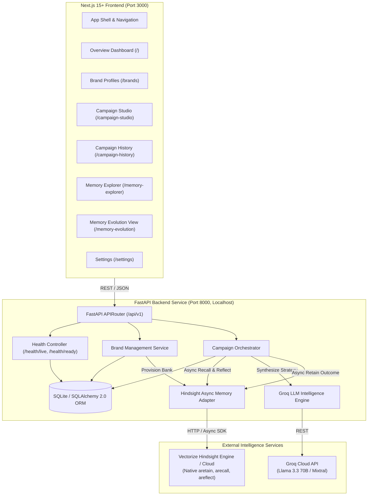
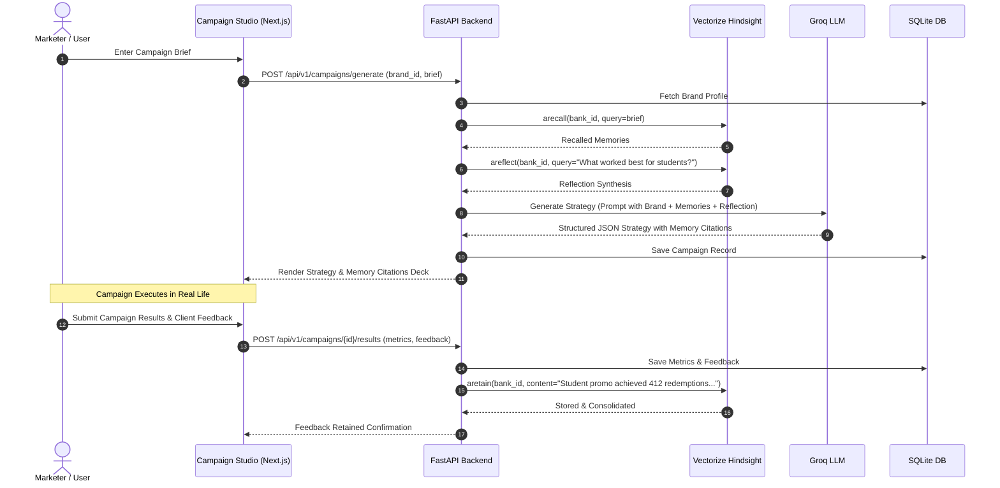

# CampaignEcho System Architecture & Technical Specification

**Category**: AI Marketing Intelligence Platform  
**Core Motto**: *"Every campaign teaches the next."*  
**Core Thesis**: Conventional AI marketing assistants produce generic content because they have no persistent brand memory. CampaignEcho continuously accumulates, recalls, and reflects upon brand-specific campaign results, audience preferences, and client feedback via Vectorize Hindsight.

---

## 1. System Overview & Component Diagram



---

## 2. Component Responsibility Division

### A. Application Database (SQLite via SQLAlchemy 2.0)
Stores relational, transactional, and audit data:
- `brands`: Brand metadata (name, industry, voice, target audience, restrictions, internal Hindsight bank ID, synthetic flag).
- `campaigns`: Campaign briefs, generated concepts, suggested platforms, status, synthetic flag, memory enabled flag.
- `campaign_metrics`: Quantitative performance metrics with decimal-safe financial fields (`NUMERIC(10,2)`), ISO currency, and nullable counts for unknown metrics.
- `campaign_feedback`: Qualitative feedback (client notes, audience response, lessons learned).
- `memory_logs`: Safe telemetry of memory operations (timestamp, operation type, context tag, item counts, latency).

### B. Memory Engine (Vectorize Hindsight)
Stores unstructured, durable, and semantic long-term memory:
- **`aretain`**: Consolidates durable brand facts, verified creative successes, documented failures, and qualitative constraints using native async calls.
- **`arecall`**: Multi-strategy context retrieval (BM25 keyword search, vector semantic similarity, temporal proximity, and graph traversal).
- **`areflect`**: Higher-order synthesis across historical campaigns (e.g., *"What creative angles have consistently delivered the lowest cost per acquisition for college students in this restaurant?"*).
- **Fallback Policy**: Real Vectorize Hindsight is required for memory claims. The system will never silently substitute a local database lookup and pretend it represents a Hindsight memory operation.

### C. LLM Engine (Groq Cloud)
Fast, structured inference provider:
- Operates on prompt templates receiving Brand Profile + Recalled Hindsight Memories + Hindsight Reflection + Current Campaign Brief.
- Returns strictly typed JSON strategies conforming to Pydantic schemas.

---

## 3. Brand Memory Isolation & Bank Lifecycle

1. **Deterministic Bank ID**:
   ```python
   bank_id = f"campaignecho-brand-{brand_id}"
   ```
2. **Idempotent Bank Provisioning**:
   - Managed server-side. Bank IDs are stored in `brands.hindsight_bank_id` and never exposed in client API responses.
3. **Tenant Boundary Enforcement**:
   - In this single-user MVP, all requests are bound to localhost.
   - The backend validates that all recall and retain requests strictly target the bank mapped to the selected `brand_id`.

---

## 4. End-to-End Campaign Workflow


