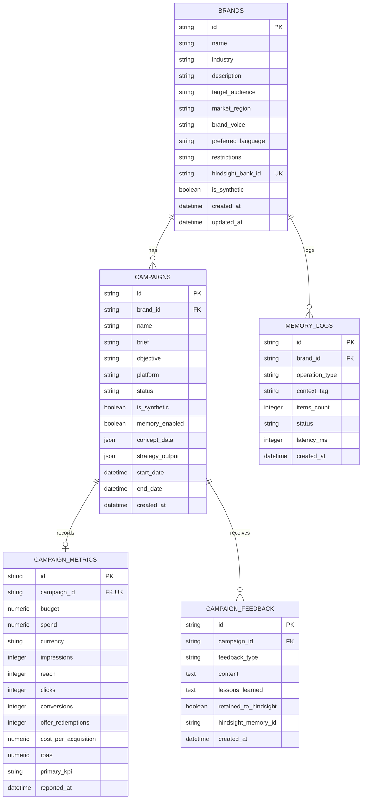

# CampaignEcho Database Schema Specification

**Engine**: SQLite 3 (via SQLAlchemy 2.0 ORM)  
**Migration Strategy**: Clean Declarative Base with Alembic Migrations  
**Design Standard**: 3NF Normalized, Decimal-Safe Monetary Types, Nullable Unknown Metrics, Explicit Foreign Keys

---

## 1. Entity-Relationship Diagram

---

## 2. Table Specifications

### A. `brands`
Stores tenant profiles and internal backend-controlled Hindsight bank identifiers.

| Column | Type | Constraints | Description |
| :--- | :--- | :--- | :--- |
| `id` | `VARCHAR(36)` | PRIMARY KEY | UUIDv4 identifier |
| `name` | `VARCHAR(255)` | NOT NULL | Brand name |
| `industry` | `VARCHAR(100)` | NOT NULL | Industry category |
| `description` | `TEXT` | NOT NULL | Brand background |
| `target_audience` | `TEXT` | NOT NULL | Audience profile summary |
| `market_region` | `VARCHAR(100)` | NOT NULL | Geographic operational market |
| `brand_voice` | `VARCHAR(100)` | NOT NULL | Tone of voice |
| `preferred_language`| `VARCHAR(20)` | DEFAULT 'en' | Language code |
| `restrictions` | `TEXT` | NULLABLE | Mandatory brand negative rules |
| `hindsight_bank_id`| `VARCHAR(128)` | UNIQUE, NULLABLE | Internal backend bank mapping (`campaignecho-brand-{id}`). Nullable in M1, populated in M2. |
| `is_synthetic` | `BOOLEAN` | DEFAULT FALSE, NOT NULL | Flag indicating synthetic/demo fixture data |
| `created_at` | `DATETIME` | NOT NULL | UTC creation timestamp |
| `updated_at` | `DATETIME` | NOT NULL | UTC update timestamp |

### B. `campaigns`
Stores marketing briefs, execution targets, and strategy records.

| Column | Type | Constraints | Description |
| :--- | :--- | :--- | :--- |
| `id` | `VARCHAR(36)` | PRIMARY KEY | UUIDv4 identifier |
| `brand_id` | `VARCHAR(36)` | FK (`brands.id`), NOT NULL | Owning brand reference |
| `name` | `VARCHAR(255)` | NOT NULL | Campaign title |
| `brief` | `TEXT` | NOT NULL | Marketing brief / user prompt |
| `objective` | `VARCHAR(100)` | NOT NULL | e.g. "Foot Traffic", "Offer Redemptions" |
| `platform` | `VARCHAR(50)` | NOT NULL | Target platform |
| `status` | `VARCHAR(30)` | DEFAULT 'DRAFT', NOT NULL | `DRAFT`, `PLANNED`, `ACTIVE`, `COMPLETED`, `ARCHIVED` |
| `is_synthetic` | `BOOLEAN` | DEFAULT FALSE, NOT NULL | Distinguishes synthetic demo campaigns from live user data |
| `memory_enabled` | `BOOLEAN` | DEFAULT TRUE, NOT NULL | Flags whether generation leveraged Hindsight memory |
| `concept_data` | `JSON` | NULLABLE | Structured creative concepts |
| `strategy_output` | `JSON` | NULLABLE | Full validated strategy payload |
| `start_date` | `DATETIME` | NULLABLE | Campaign launch date |
| `end_date` | `DATETIME` | NULLABLE | Campaign end date |
| `created_at` | `DATETIME` | NOT NULL | Creation timestamp (UTC) |

### C. `campaign_metrics`
Stores quantitative performance data after campaign execution. Note: All metrics are **nullable** to prevent confusing missing/unreported data with true zero performance. Financial amounts use **decimal-safe `NUMERIC(10,2)`** with explicit ISO currency codes.

| Column | Type | Constraints | Description |
| :--- | :--- | :--- | :--- |
| `id` | `VARCHAR(36)` | PRIMARY KEY | UUIDv4 identifier |
| `campaign_id` | `VARCHAR(36)` | FK (`campaigns.id`), UNIQUE, NOT NULL | 1:1 relation to campaign |
| `budget` | `NUMERIC(10,2)` | NULLABLE | Allocated budget |
| `spend` | `NUMERIC(10,2)` | NULLABLE | Actual spend |
| `currency` | `VARCHAR(3)` | DEFAULT 'USD', NOT NULL | ISO 4217 3-letter currency code |
| `impressions` | `INTEGER` | NULLABLE | Raw impressions count (NULL if unmeasured) |
| `reach` | `INTEGER` | NULLABLE | Unique accounts reached (NULL if unmeasured) |
| `clicks` | `INTEGER` | NULLABLE | Link clicks (NULL if unmeasured) |
| `conversions` | `INTEGER` | NULLABLE | Conversions (NULL if unmeasured) |
| `offer_redemptions`| `INTEGER` | NULLABLE | Specific voucher/code redemptions |
| `cost_per_acquisition`| `NUMERIC(10,2)` | NULLABLE | Calculated or reported CPA |
| `roas` | `NUMERIC(10,2)` | NULLABLE | Return on ad spend multiplier |
| `primary_kpi` | `VARCHAR(50)` | NOT NULL | Target KPI identifier |
| `reported_at` | `DATETIME` | NOT NULL | Date results were filed |

### D. `campaign_feedback`
Stores qualitative reviews and lessons retained into Hindsight.

| Column | Type | Constraints | Description |
| :--- | :--- | :--- | :--- |
| `id` | `VARCHAR(36)` | PRIMARY KEY | UUIDv4 identifier |
| `campaign_id` | `VARCHAR(36)` | FK (`campaigns.id`), NOT NULL | Associated campaign |
| `feedback_type` | `VARCHAR(50)` | NOT NULL | `CLIENT_REVIEW`, `AUDIENCE_REACTION`, `POST_MORTEM` |
| `content` | `TEXT` | NOT NULL | Qualitative notes |
| `lessons_learned` | `TEXT` | NOT NULL | Formulated takeaway |
| `retained_to_hindsight`| `BOOLEAN` | DEFAULT FALSE, NOT NULL | Retention confirmation flag |
| `hindsight_memory_id`| `VARCHAR(128)` | NULLABLE | ID returned by Hindsight on retention |
| `created_at` | `DATETIME` | NOT NULL | Timestamp |

### E. `memory_logs`
Privacy-safe audit telemetry for memory operations. Stores operation metadata, counts, and timing without logging sensitive customer conversation contents.

| Column | Type | Constraints | Description |
| :--- | :--- | :--- | :--- |
| `id` | `VARCHAR(36)` | PRIMARY KEY | UUIDv4 identifier |
| `brand_id` | `VARCHAR(36)` | FK (`brands.id`), NOT NULL | Targeted brand |
| `operation_type` | `VARCHAR(20)` | NOT NULL | `RETAIN`, `RECALL`, `REFLECT` |
| `context_tag` | `VARCHAR(100)` | NULLABLE | High-level non-sensitive tag (e.g. "campaign-brief", "post-mortem") |
| `items_count` | `INTEGER` | DEFAULT 0, NOT NULL | Count of memories retained or recalled |
| `status` | `VARCHAR(30)` | NOT NULL | `SUCCESS`, `TIMEOUT`, `ERROR` |
| `latency_ms` | `INTEGER` | NOT NULL | Operation round-trip latency in ms |
| `created_at` | `DATETIME` | NOT NULL | Timestamp |
