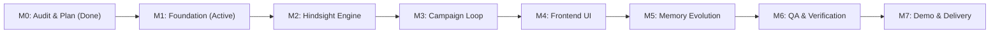

# CampaignEcho Implementation Roadmap & Milestone Plan

**Status**: MILESTONE 0 COMPLETE & APPROVED — MILESTONE 1 IN PROGRESS  
**Execution Standard**: Discipline-first, phase-based milestones with verification checkpoints.

---

## 1. Milestone Roadmap Overview

---

## 2. Milestone Breakdown & Definition of Done

### Milestone 0: Environment Audit, Architecture & Planning (COMPLETED)
- **Status**: Completed. Baseline specifications approved with corrections for decimal monetary types, async Hindsight methods, isolated internal bank IDs, and standardized health probes.

### Milestone 1: Full-Stack Foundation (ACTIVE)
- **Scope**:
  - **Backend**:
    - FastAPI application factory in `backend/app/main.py`.
    - Pydantic v2 settings management in `backend/app/core/config.py`.
    - Structured logging in `backend/app/core/logging.py`.
    - Explicit CORS configuration allowing local frontend development origins.
    - SQLAlchemy 2.0 ORM models in `backend/app/db/models.py` (`Brand`, `Campaign`, `CampaignMetrics`, `CampaignFeedback`, `MemoryLog`) with corrected decimal types, nullable metrics, and `is_synthetic` flag.
    - SQLite foreign key pragma enforcement.
    - Alembic migrations environment initialized with successful upgrade head.
    - Standardized health endpoints:
      - `GET /api/v1/health/live`: Process liveness check.
      - `GET /api/v1/health/ready`: Database connectivity check (returns 503 if DB unreachable).
    - Backend test suite with Pytest using temporary SQLite test database.
  - **Frontend**:
    - Next.js App Router in `frontend/` with TypeScript (strict mode) and Tailwind CSS.
    - Design Reference Lock tokens: Editorial SaaS Darkroom palette, Inter & JetBrains Mono typography.
    - Base responsive App Shell: Collapsible navigation sidebar, header, and overview foundation.
    - Live health telemetry card connected to real backend `/api/v1/health/ready` probe.
    - Explicit status chips: Backend (Live/Unreachable), Database (Connected/Disconnected), Hindsight (Not integrated yet), Groq (Not integrated yet).
    - Production build verification (`npm run build`).
  - **Acceptance Criteria**:
    - Backend starts on port 8000 and answers health probes.
    - Frontend starts on port 3000 and dynamically loads real backend status.
    - Pytest tests pass cleanly.
    - Alembic migrations run cleanly.
    - Playwright smoke test passes with zero browser console errors.

### Milestone 2: Hindsight Memory Engine Integration
- **Scope**: Real `hindsight-client` native async integration (`aretain`, `arecall`, `areflect`), deterministic bank provisioning (`campaignecho-brand-{id}`), memory isolation verification across process restarts.

### Milestone 3: Campaign Orchestration & Learning Loop
- **Scope**: Groq LLM integration (`llama-3.3-70b-versatile`), strategy synthesis with memory citations, campaign results recording and feedback retention loop.

### Milestone 4: Frontend Product Screens
- **Scope**: Implementation of the 6 core views (Overview, Brands, Campaign Studio, Campaign History, Memory Explorer, Settings).

### Milestone 5: Signature Feature — Memory Evolution
- **Scope**: Dynamic side-by-side comparison mode (Without Memory vs. With Memory) on identical briefs with evidence-based delta analysis.

### Milestone 6: Verification, Visual QA & Ponytail Audit
- **Scope**: Automated Playwright browser tests across viewports, Ponytail review and audit to remove premature abstractions and dead code.

### Milestone 7: Demo Packaging & Presentation Delivery
- **Scope**: Seed synthetic restaurant dataset ("The Taco Syndicate"), one-command startup scripts, verified 60s & 3m demo scenarios.

---

## 3. Risk Register & Mitigation Matrix

| Risk ID | Risk Description | Probability | Impact | Mitigation Strategy |
| :--- | :--- | :--- | :--- | :--- |
| **R-1** | Hindsight credentials or network timeout | Med | High | Proper timeout handling (`arecall` with timeout) and clear user-facing error reporting. Never substitute fake local memories and claim they represent Hindsight. |
| **R-2** | Groq API rate limits during rapid generation | Low | Med | Implement exponential backoff retry and cache brief outputs locally in SQLite. |
| **R-3** | Cross-brand memory contamination | Low | Critical | Strict deterministic naming `campaignecho-brand-{id}` enforced server-side. Rigorous isolation unit tests. |
| **R-4** | Frontend visual regression / generic AI styling | Low | High | Strict adherence to `docs/DESIGN_REFERENCE_LOCK.md` and Playwright visual screenshot audits. |
