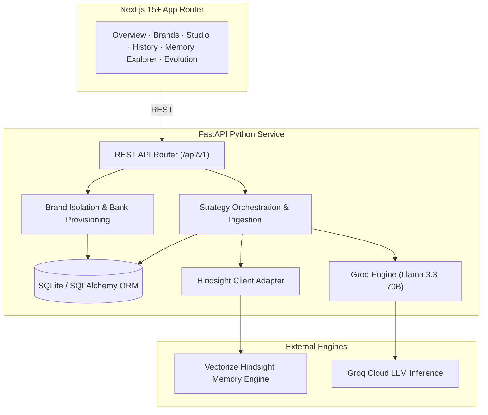

# CampaignEcho 📣

> *"Every campaign teaches the next."*

CampaignEcho is an enterprise-grade AI marketing intelligence platform that learns from a business's historical campaigns, brand voice, target audience preferences, client feedback, and actual performance metrics.

Unlike conventional AI marketing assistants that generate generic, repetitive captions and ungrounded campaign ideas, CampaignEcho maintains persistent, brand-specific memory banks powered by **Vectorize Hindsight**. The more a brand uses CampaignEcho, the more contextual, defensive, and effective its marketing strategies become.

---

## 🌟 The Core Differentiator: Persistent Brand Memory

Marketing knowledge is typically scattered across analytics dashboards, WhatsApp messages, client PDFs, and spreadsheets. When agencies plan their next campaign, past lessons are routinely forgotten:
- High-performing hooks are abandoned.
- Painful past failures are repeated with the same audience.
- Tone restrictions must be re-explained to generic AI models.

CampaignEcho solves this by executing three foundational memory operations via Vectorize Hindsight:
1. **Retain**: Consolidates verified brand rules, performance metrics, and post-mortem feedback into an isolated memory bank.
2. **Recall**: Contextually retrieves relevant past strategies and audience reactions before generating new campaigns.
3. **Reflect**: Synthesizes cross-campaign patterns to deduce what consistently drives conversions for that specific brand.

---

## 🏗️ Architecture & Tech Stack



- **Frontend**: Next.js 15+ (App Router), TypeScript, Tailwind CSS, shadcn/ui, Lucide Icons, Recharts, GSAP Core.
- **Backend**: Python 3.11+, FastAPI, Pydantic v2 validation, SQLAlchemy 2.0 ORM, SQLite.
- **Memory Engine**: Vectorize Hindsight (`hindsight-client` Python SDK).
- **LLM Engine**: Groq Cloud API (`llama-3.3-70b-versatile`).
- **Testing & Verification**: Pytest, Playwright Browser Automation MCP, Ponytail Code Audit.

---

## 🚀 Quickstart Guide

### Prerequisites
- Node.js 20+ (Node v26 verified)
- Python 3.11+ (Python 3.13 verified)
- Git 2.40+ (Git 2.56 verified)

### 1. Environment Setup
```bash
# Clone or navigate to the repository
cd C:\CampaignEcho

# Copy environment template
cp .env.example .env
```

### 2. Backend Initialization
```bash
# Create and activate virtual environment
python -m venv venv
# Windows:
.\venv\Scripts\activate

# Install dependencies
pip install -r backend/requirements.txt

# Run database migrations and seed demo data
python backend/scripts/seed_demo.py

# Launch FastAPI server (port 8000)
uvicorn backend.app.main:app --host 0.0.0.0 --port 8000 --reload
```

### 3. Frontend Initialization
```bash
cd frontend
npm install
npm run dev
# Open http://localhost:3000
```

---

## 📚 Complete Project Documentation

| Document | Purpose |
| :--- | :--- |
| **[AGENTS.md](file:///c:/CampaignEcho/AGENTS.md)** | Agent Engineering Rules, Behavioral Constitution, and Quality Standards |
| **[ARCHITECTURE.md](file:///c:/CampaignEcho/ARCHITECTURE.md)** | Detailed System Architecture, Component Division, and Sequence Flows |
| **[DATABASE_SCHEMA.md](file:///c:/CampaignEcho/DATABASE_SCHEMA.md)** | Entity-Relationship Diagram, Table Specs, and Synthetic Seed Data |
| **[API_CONTRACT.md](file:///c:/CampaignEcho/API_CONTRACT.md)** | REST Endpoints, Pydantic Request/Response Models, and Status Codes |
| **[TEST_PLAN.md](file:///c:/CampaignEcho/TEST_PLAN.md)** | Critical Cross-Session Acceptance Tests, Pytest Suites, and Playwright QA |
| **[IMPLEMENTATION_PLAN.md](file:///c:/CampaignEcho/IMPLEMENTATION_PLAN.md)** | Detailed Milestone Roadmap (M0-M7) and Risk Register |
| **[docs/DESIGN_REFERENCE_LOCK.md](file:///c:/CampaignEcho/docs/DESIGN_REFERENCE_LOCK.md)** | Locked Visual Tokens, Color Palette, Typography, and Interaction Rules |
| **[docs/TOOLING_INVENTORY.md](file:///c:/CampaignEcho/docs/TOOLING_INVENTORY.md)** | Global Antigravity Environment, Skills, and MCP Inventory |
| **[docs/DEMO_SCENARIO.md](file:///c:/CampaignEcho/docs/DEMO_SCENARIO.md)** | 60-Second Elevator Pitch & 3-Minute Walkthrough Script |
| **[docs/PROGRESS.md](file:///c:/CampaignEcho/docs/PROGRESS.md)** | Living Project Status and Milestone Tracker |
| **[docs/DECISIONS.md](file:///c:/CampaignEcho/docs/DECISIONS.md)** | Architectural Decision Records (ADRs) |

