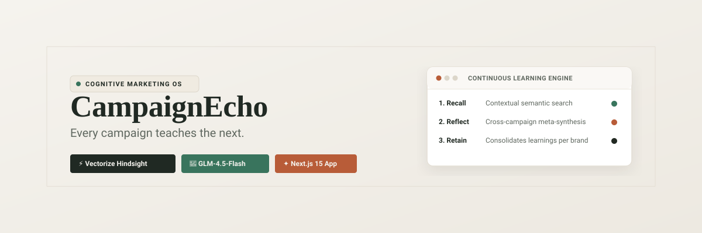
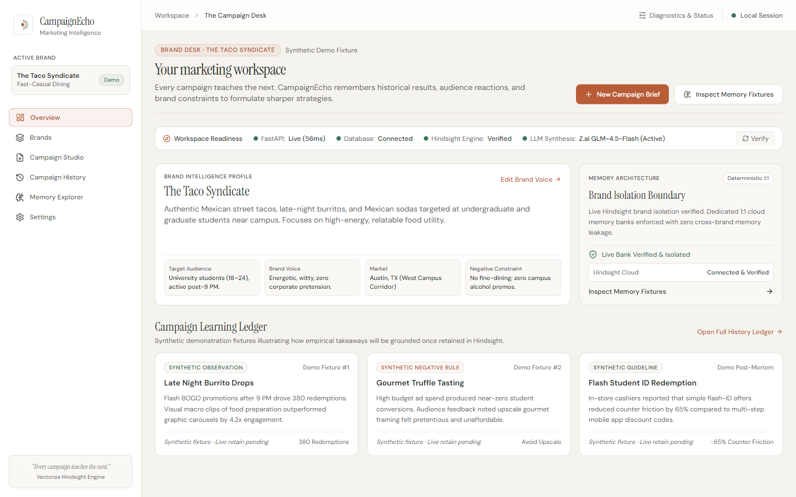
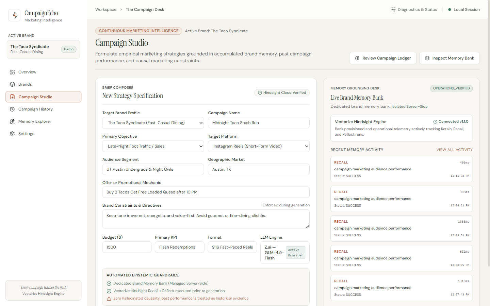
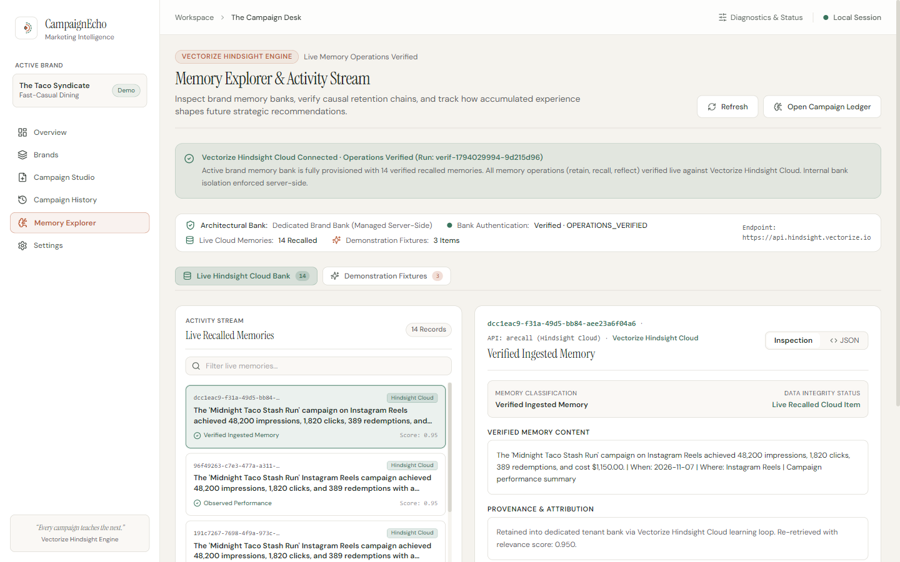
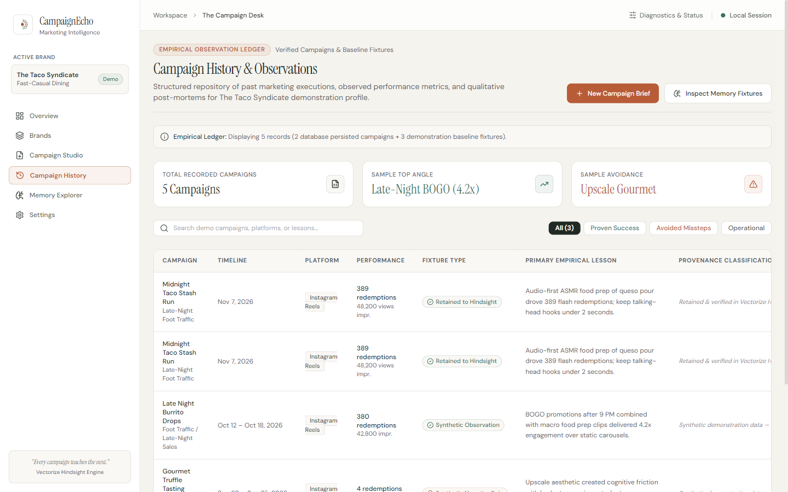
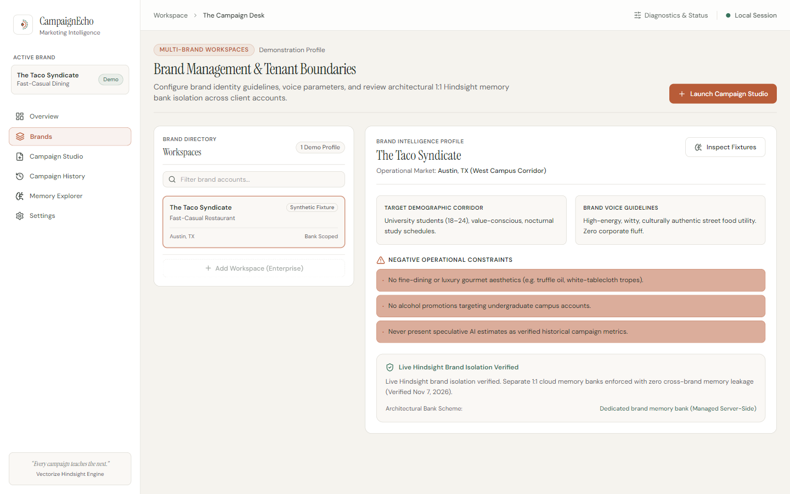
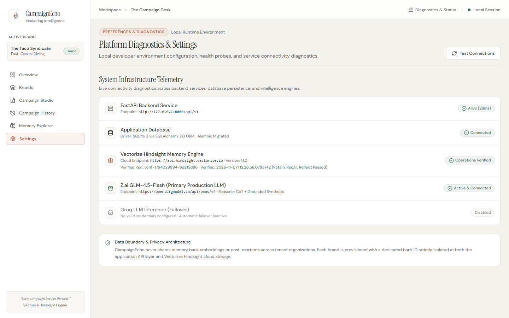
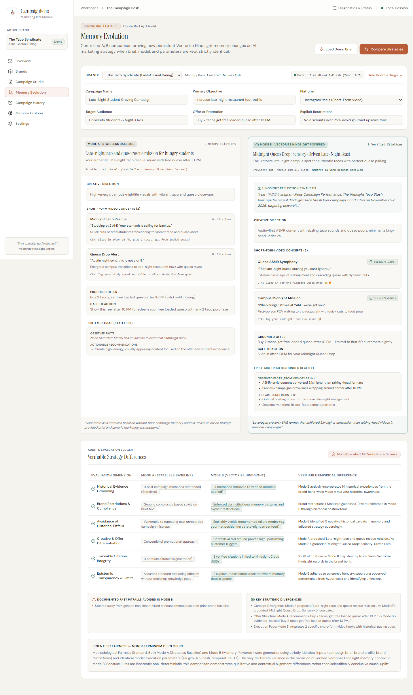
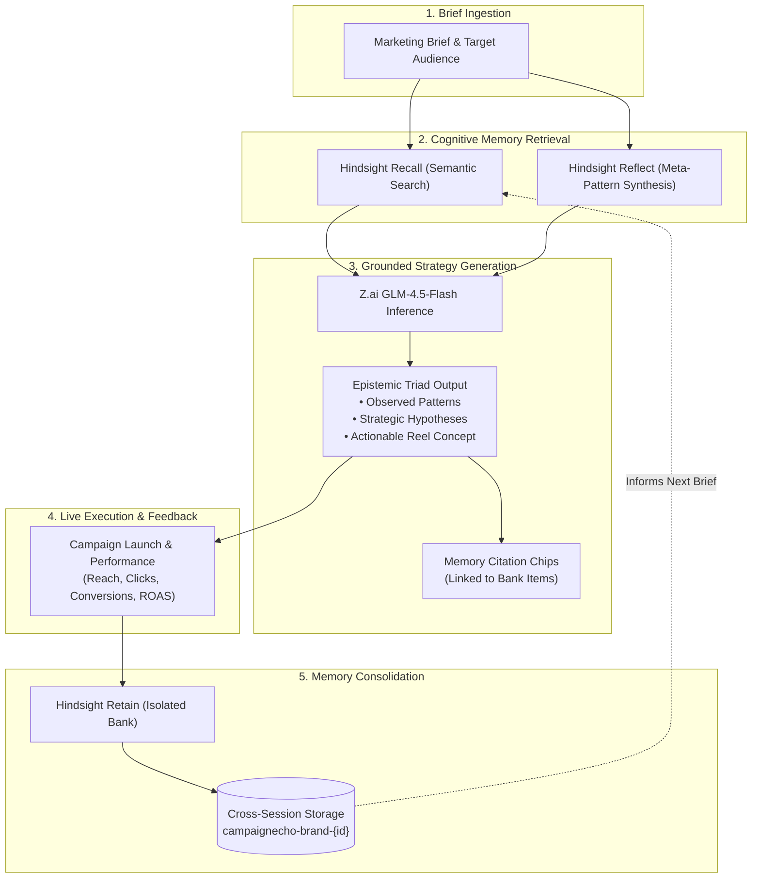
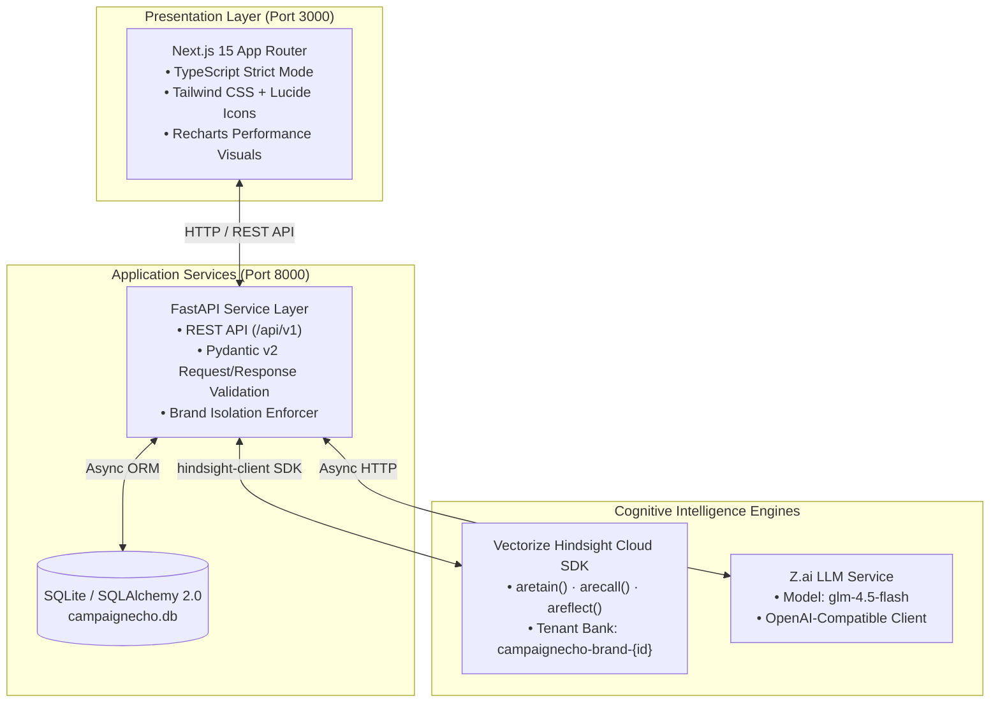

<div align="center">



# CampaignEcho

### *Every Campaign Teaches the Next.*

**Memory-Powered AI Marketing Intelligence Platform**  
*Built with Vectorize Hindsight, Z.ai GLM-4.5-Flash, Next.js 15, and FastAPI.*

[](LICENSE)
[](https://hindsight.vectorize.io)
[](https://z.ai)
[](https://nextjs.org)
[](https://fastapi.tiangolo.com)
[](docs/PROGRESS.md)
[](docs/PROGRESS.md)

</div>

---

## ✦ The Problem: The Stateless AI Trap

Marketing teams running repetitive AI prompts hit an invisible wall:

1. **Context Amnesia**: Every new chat window starts from tabula rasa. High-performing hooks discovered three months ago are forgotten, and tone guidelines must be manually restated.
2. **Repetition of Costly Failures**: Without persistent institutional memory, generative models repeatedly recommend tactics that already flopped with that specific audience.
3. **Ungrounded Hallucinations**: Standard LLMs cannot distinguish between speculative ideas, historical patterns, and empirically observed conversion metrics.

**CampaignEcho replaces stateless prompt generation with a continuous cognitive feedback loop.** By pairing **Vectorize Hindsight** with modern generative LLMs, CampaignEcho maintains strict, tenant-isolated memory banks for every brand. Every brief recalls verified learnings; every campaign outcome retains new institutional truth.

---

## ✦ Visual Product Tour

The CampaignEcho workspace is designed around the **Campaign Desk** design system—prioritizing typographical clarity, information density, and epistemic honesty.

### 1. Executive Intelligence Overview
*Real-time readiness telemetry, brand-isolated bank provisioning, and cognitive activity feeds.*


### 2. Campaign Studio & Epistemic Triad
*Interactive brief configuration, contextual memory recall, cross-campaign reflections, and grounded reel strategies with verified memory citations.*


### 3. Memory Explorer & Bank Inspector
*Direct visibility into the Vectorize Hindsight memory bank. Search semantic memory, inspect reflection synthesis, and verify retention timestamps.*


### 4. Campaign History & Performance Ledger
*Track historical campaign lifecycles from concept generation to live performance ingestion and automated memory consolidation.*


### 5. Multi-Brand Directory & Memory Isolation
*Strict 1:1 tenant isolation. Brand banks are mapped deterministically (`campaignecho-brand-{id}`) with zero cross-tenant contamination.*


### 6. System & Infrastructure Telemetry
*Verifiable runtime telemetry connecting Hindsight Cloud, Z.ai inference, and SQLite persistence.*


### 7. Memory Evolution (Controlled A/B Strategy Audit)
*Controlled side-by-side strategy audit comparing stateless baseline generation against Vectorize Hindsight memory grounding with a 6-dimension verifiable differences ledger and zero fake percentage scores.*


---

## ✦ The Core Cognitive Learning Loop

Unlike conventional AI tools that terminate once copy is generated, CampaignEcho forms a closed-loop learning cycle:



---

## ✦ System Architecture

CampaignEcho divides responsibilities cleanly between an editorial Next.js frontend, an asynchronous FastAPI service layer, and external cognitive intelligence engines.



---

## ✦ Cognitive Primitives & Epistemic Honesty

CampaignEcho implements the three foundational cognitive primitives of **Vectorize Hindsight**:

### 1. Contextual Recall (`arecall`)
Before drafting any strategy, CampaignEcho queries the brand's memory bank using semantic similarity:
```python
# Contextually retrieves verified historical precedents
recalled_memories = await hindsight_client.arecall(
    bank_id=f"campaignecho-brand-{brand_id}",
    query=f"{brief.goal} targeting {brief.target_audience}",
    limit=10
)
```

### 2. High-Order Reflection (`areflect`)
Rather than relying purely on isolated fragments, CampaignEcho triggers higher-order reflection over past campaign trajectories:
```python
# Synthesizes cross-campaign behavioral patterns
reflection = await hindsight_client.areflect(
    bank_id=f"campaignecho-brand-{brand_id}",
    query="What hooks and messaging angles have generated the highest engagement for this audience?"
)
```

### 3. Continuous Retention (`aretain`)
When actual campaign analytics and post-mortem observations are reported, learnings are consolidated into the bank:
```python
# Permanently commits post-campaign performance to memory
await hindsight_client.aretain(
    bank_id=f"campaignecho-brand-{brand_id}",
    content=f"Campaign '{campaign.title}' achieved {results.clicks} clicks with {results.roas}x ROAS. Key learning: {results.key_takeaway}",
    metadata={"campaign_id": campaign.id, "verified": True}
)
```

### The Epistemic Triad
In accordance with CampaignEcho architectural standards, AI outputs must never claim false causality:
- **Observed Performance**: Grounded empirical data recalled directly from memory.
- **Historical Patterns**: Cross-campaign reflections synthesized by Hindsight.
- **Strategic Hypotheses**: Deductive creative recommendations generated by the LLM.

---

## ✦ Technology Stack

| Component | Technology | Version | Purpose |
| :--- | :--- | :--- | :--- |
| **Frontend Framework** | Next.js (App Router) | `15.0.3` | Server & client React component rendering |
| **Language** | TypeScript | `5.6+` | Strict type safety across the client application |
| **Styling & UI** | Tailwind CSS / shadcn/ui | `3.4+` | Campaign Desk editorial styling system |
| **Iconography** | Lucide React | `0.454+` | Clean, minimalist interface icons |
| **Visualization** | Recharts | `2.13+` | Metric distributions and performance charting |
| **Backend Framework** | FastAPI | `0.115+` | High-throughput asynchronous REST API |
| **Data Validation** | Pydantic | `v2.9+` | Strict schema serialization and contract enforcement |
| **Persistence** | SQLite / SQLAlchemy | `2.0+` | Local database for brands, briefs, and campaigns |
| **Memory Engine** | Vectorize Hindsight SDK | `hindsight-client` | Cloud cognitive memory (`retain`, `recall`, `reflect`) |
| **LLM Inference** | Z.ai (`glm-4.5-flash`) | Latest | Fast, high-context campaign strategy generation |
| **Browser QA** | Playwright MCP | `1.48+` | Automated cross-viewport UI and console regression testing |

---

## ✦ Quickstart for Evaluators (One-Command Launch)

For competition judges and evaluators, CampaignEcho provides fully automated PowerShell scripts to test and run the entire platform in seconds:

> [!NOTE]
> **Synthetic Data & Provenance Disclosure**: *The Taco Syndicate* brand profile and seeded performance metrics (e.g. 48,200 impressions, 389 redemptions) are synthetic evaluation fixtures (`is_synthetic = True`). All Vectorize Hindsight Cloud operations (`aretain`, `arecall`, `areflect`) and Z.ai model inferences are real live cloud operations.

```powershell
# 1. Run environment diagnostics (validates Python >= 3.11, Node >= 20, 8 DB tables, live Hindsight Cloud & Z.ai gateway)
.\scripts\check-demo.ps1

# 2. Apply database migrations to current schema
alembic upgrade head

# 3. Seed demonstration fixtures (idempotent; seeds "The Taco Syndicate")
python scripts/seed_demo.py

# 4. Launch both backend (:8000) and frontend (:3000) with strict process tracking
.\scripts\start-demo.ps1

# 5. Open in your browser:
#    Main Dashboard:    http://localhost:3000
#    Memory Evolution:  http://localhost:3000/memory-evolution
#    Memory Explorer:   http://localhost:3000/memory-explorer
#    Interactive Docs:  http://127.0.0.1:8000/docs

# 6. Cleanly shut down when finished (verifies PID, token, and releases ports 8000 & 3000)
.\scripts\stop-demo.ps1
```

For step-by-step instructions, see [docs/EVALUATOR_GUIDE.md](docs/EVALUATOR_GUIDE.md) and [docs/FINAL_DEMO_RUNBOOK.md](docs/FINAL_DEMO_RUNBOOK.md).

---

## ✦ Manual Installation & Development Setup

### Prerequisites
- **Python**: 3.11 or higher (Python 3.13 tested)
- **Node.js**: 20.0 or higher (Node v26 tested)
- **Git**: 2.40 or higher

### 1. Clone & Environment Configuration

```powershell
# Clone the repository
git clone https://github.com/ahg8618364360-ctrl/CampaignEcho.git
cd CampaignEcho

# Copy environment template
Copy-Item .env.example .env
```

Edit `.env` to configure your API keys:
```ini
# Hindsight Configuration
HINDSIGHT_API_URL=https://api.hindsight.vectorize.io
HINDSIGHT_API_KEY=your_hindsight_api_key_here

# LLM Engine (Z.ai GLM-4.5-Flash)
ZAI_API_KEY=your_zai_api_key_here
LLM_PROVIDER=zai
LLM_MODEL=glm-4.5-flash
```

### 2. Backend Initialization

```powershell
# Create and activate Python virtual environment
python -m venv venv
.\venv\Scripts\Activate.ps1

# Install backend package in editable mode via pyproject.toml
pip install -e .

# Apply Alembic schema migrations
alembic upgrade head

# Seed verified demonstration brand and historical campaigns
python scripts/seed_demo.py

# Launch FastAPI development server (port 8000)
uvicorn backend.app.main:app --host 127.0.0.1 --port 8000 --reload
```

The interactive API documentation is accessible at `http://127.0.0.1:8000/docs`.

### 3. Frontend Initialization

```powershell
# Navigate to frontend directory
cd frontend

# Install dependencies
npm install

# Run development server (port 3000)
npm run dev
```

Open `http://localhost:3000` in your browser.

---

## ✦ Verification & Quality Proof

CampaignEcho adheres to a strict **Verification Before Completion** standard. All claims are grounded in verifiable execution evidence:

- **CI Test Suite**: **41 unit, contract, and security tests passed** in CI (6 live cloud integration tests excluded in CI via `-k "not test_critical_ and not test_live_continuous_learning_loop_e2e"`).
- **Full Local Pytest Suite**: **47 total tests passed** in `backend/tests/` (including all 6 live Vectorize Hindsight Cloud integration and continuous learning loop tests).
- **Security Regression Suite**: **8/8 automated security regression tests passed** (`scripts/test_security_regressions.ps1`).
- **User Acceptance Testing (UAT)**: **21/21 responsive routes passed** across Desktop (1440x900), Tablet (768x1024), and Mobile (390x844) with **zero console errors** and **zero horizontal overflow violations**, plus **5/5 end-to-end strategic user journey steps passed**.
- **Frontend Typecheck**: `tsc --noEmit` exits with **0 errors**.
- **Frontend Lint**: `next lint` reports **0 warnings, 0 errors**.
- **Production Build**: `next build` compiles all application routes statically without hydration issues.

To run the complete verification suite locally:
```powershell
# Run CI backend tests
pytest backend/tests/ -v -k "not test_critical_ and not test_live_continuous_learning_loop_e2e"

# Run full backend test suite (including live cloud operations)
pytest backend/tests/ -v

# Run security regression tests
powershell -ExecutionPolicy Bypass -File scripts\test_security_regressions.ps1

# Run integrated demo and browser UAT suite
powershell -ExecutionPolicy Bypass -File scripts\run_integrated_uat.ps1

# Run frontend checks
cd frontend
npm run typecheck
npm run lint
npm run build
```

---

## ✦ Repository Layout

```
CampaignEcho/
├── .env.example                   # Grounded configuration template
├── README.md                      # Platform documentation & overview
├── LICENSE                        # Apache 2.0 Open Source License
├── SECURITY.md                    # Responsible disclosure & tenant isolation policy
├── CONTRIBUTING.md                # Contribution workflow & quality gates
├── AGENTS.md                      # Engineering constitution & architectural laws
├── ARCHITECTURE.md                # Detailed component design & sequence flows
├── API_CONTRACT.md                # REST API specifications & schemas
├── DATABASE_SCHEMA.md             # SQLite / SQLAlchemy data models
├── TEST_PLAN.md                   # Pytest & Playwright verification plan
├── IMPLEMENTATION_PLAN.md         # Milestone execution roadmap
├── backend/                       # Python FastAPI backend
│   ├── app/                       # Application routers, services, & database
│   │   ├── api/v1/                # Brands, campaigns, and memory endpoints
│   │   ├── core/                  # Configuration & database session
│   │   ├── models/                # SQLAlchemy database entities
│   │   ├── schemas/               # Pydantic v2 schemas
│   │   └── services/              # Hindsight memory & Z.ai adapters
│   ├── requirements.txt           # Python backend dependencies
│   ├── scripts/                   # Database seeding & verification scripts
│   └── tests/                     # Unit, integration, & E2E tests (47 tests: 41 CI / 6 live cloud)
├── frontend/                      # Next.js 15 App Router application
│   ├── src/                       # Page routes, components, hooks, & types
│   │   ├── app/                   # App Router pages (Overview, Studio, Memory, etc.)
│   │   ├── components/            # Design system widgets & citation chips
│   │   └── lib/                   # API client & typography utilities
│   ├── package.json               # Node.js dependencies
│   └── tailwind.config.ts         # Campaign Desk color tokens & spacing
└── docs/                          # Architectural documentation & design records
    ├── assets/readme/             # Curated screenshots & vector diagrams
    ├── screenshots/               # Verified Playwright browser captures
    ├── DESIGN_REFERENCE_LOCK.md   # Visual design authority & palette locks
    ├── PROGRESS.md                # Living milestone execution tracker
    └── DECISIONS.md               # Architectural Decision Records (ADRs)
```

---

## ✦ Documentation Directory

- **[AGENTS.md](AGENTS.md)**: Agent Engineering Rules, Behavioral Constitution, and Quality Standards
- **[ARCHITECTURE.md](ARCHITECTURE.md)**: Detailed System Architecture, Component Division, and Sequence Flows
- **[DATABASE_SCHEMA.md](DATABASE_SCHEMA.md)**: Entity-Relationship Diagram, Table Specs, and Synthetic Seed Data
- **[API_CONTRACT.md](API_CONTRACT.md)**: REST Endpoints, Pydantic Request/Response Models, and Status Codes
- **[TEST_PLAN.md](TEST_PLAN.md)**: Pytest Suites, Continuous Learning Loop Verification, and Playwright QA
- **[IMPLEMENTATION_PLAN.md](IMPLEMENTATION_PLAN.md)**: Milestone Execution Roadmap & Acceptance Gates
- **[docs/DESIGN_REFERENCE_LOCK.md](docs/DESIGN_REFERENCE_LOCK.md)**: Visual Tokens, Palette, Typography, and Interaction Rules
- **[docs/DEMO_SCENARIO.md](docs/DEMO_SCENARIO.md)**: Elevator Pitch Script & Product Walkthrough Guide
- **[docs/PROGRESS.md](docs/PROGRESS.md)**: Milestone Tracker & Verification History
- **[docs/DECISIONS.md](docs/DECISIONS.md)**: Architectural Decision Records (ADRs)

---

## ✦ License

This project is licensed under the Apache 2.0 License. See the [LICENSE](LICENSE) file for details.
